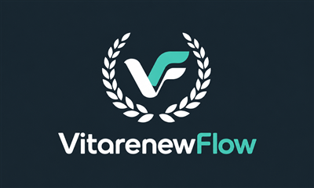

# VitarenewFlow

A Nintendo 3DS game launcher by [VitaRenew](https://vitarenew.de).

**Development milestone 0.11.0 — not version 1.0. Native CIA installation and handoffs still need real-console acceptance.**

Deutsch: Eine gemeinsame Bibliothek für 3DS-Spiele, DS und Emulatoren, mit Coverflow, Originalbanner-Caches, CIA-Installation und Seed-Reparatur. Die bisherigen 3DSX-Spielstarts wurden auf einem New Nintendo 3DS XL getestet. Das neue CIA-Paket ist noch nicht auf der Konsole abgenommen.

English: One library for 3DS games, DS and emulators, with coverflow, original banner caches, CIA installation and seed repair. Existing 3DSX launch routes were tested on a New Nintendo 3DS XL. The new native CIA package still needs hardware acceptance.

## Current additions

- Approved VF/laurel branding and startup art without an extra splash delay.
- Persistent English/German language selection in Settings.
- Optional VitaRenew support panel under Settings → More settings.
- Native CIA package with icon and HOME banner.
- Native CIA handoff to the configured Rosalina takeover title for 3DSX emulators.

## Install / Installation

See [test installation](docs/INSTALL.md). This milestone updates an existing project SD; it does not bundle games, artwork, BIOS files, keys or emulator binaries. The emulator integrations require the project's tested adapters. A clean end-user installer follows the remaining hardware milestones.

[Next console test](docs/acceptance/TEST-0.11.0.md) · [Final acceptance checklist](docs/acceptance/FINAL-1.0.md) · [Roadmap](docs/ROADMAP.md)

## Build

- 3DS: devkitPro devkitARM, libctru, citro2d/citro3d, libpng and zlib. Run `make -C launcher` with DEVKITPRO/DEVKITARM configured.
- CIA: makerom 0.19.0 and bannertool 1.2.3 from their official repositories; see `scripts/build-cia.ps1`.
- Windows desktop: .NET Framework 4.x/WPF; run `desktop/source/build.ps1`. Compatible filename: `3DS Library PC.exe`.
- Host feature tests: `sh scripts/test-host.sh` with a C compiler and UBSan available.

Data paths remain under `/3ds/3ds-library` for compatibility.

## Notices

Source is available for development review. Reuse licensing for original project code and branding will be finalized before 1.0. Third-party components retain their own licenses; see [notices](licenses/NOTICES.md). No GodMode9 implementation is included in the launcher.
